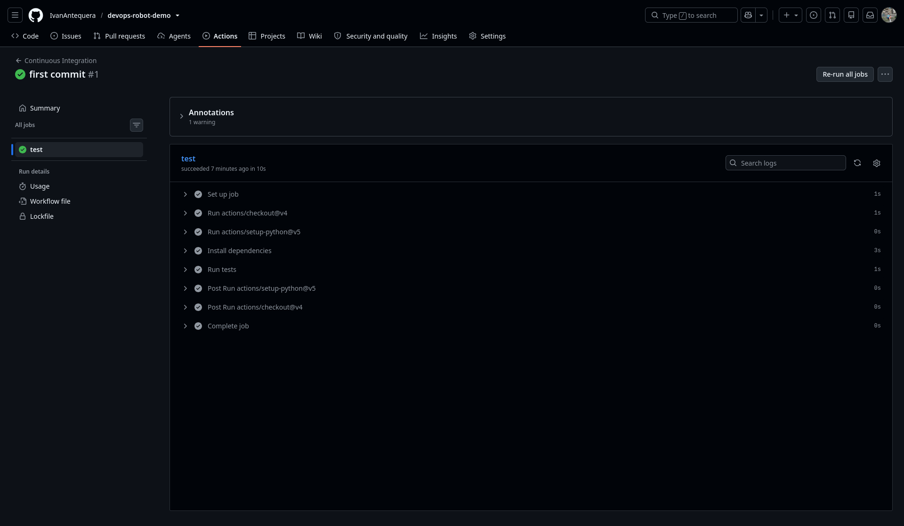

# devops-robot-demo

## Fase 1
### Pregunta
¿Qué ocurre exactamente en el valor límite de 0.5 metros?

En 0.5 metros, can_move devuelve False, porque la condición usa > y no >=. Solo devuelve True para distancias mayores que 0.5 metros.

## Fase 2.5



### Comprobación

¿Qué evento dispara el pipeline? ¿Qué ocurriría si se modifica el código sin ejecutar las pruebas
localmente?

El pipeline es disparado por los eventos push y pull_request en la rama main como se muestra en el fichero .github/workflows/ci.yml:

```yaml
on:
  push:
    branches: [main]
  pull_request:
    branches: [main]
```

Si modificas el código sin ejecutar las pruebas localmente, el workflow las ejecutará en GitHub Actions. Si alguna falla, el pipeline aparecerá como fallido y puede bloquear la integración, según la configuración del repositorio. Si pasan, eso confirma que esas pruebas pasan en el entorno del pipeline, aunque no garantiza que no haya otros problemas.

Identificación de que pruebas fallaron y por qué 3.1:

Run python -m pytest -v
============================= test session starts ==============================
platform linux -- Python 3.12.16, pytest-9.2.0, pluggy-1.7.0 -- /opt/hostedtoolcache/Python/3.12.16/x64/bin/python
cachedir: .pytest_cache
rootdir: /home/runner/work/devops-robot-demo/devops-robot-demo
collecting ... collected 4 items

test_robot.py::test_safe_distance PASSED                                 [ 25%]
test_robot.py::test_unsafe_distance FAILED                               [ 50%]
test_robot.py::test_boundary_distance FAILED                             [ 75%]
test_robot.py::test_invalid_distance PASSED                              [100%]

=================================== FAILURES ===================================
_____________________________ test_unsafe_distance _____________________________

    def test_unsafe_distance():
>       assert can_move(0.2) is False
E       assert True is False
E        +  where True = can_move(0.2)

test_robot.py:10: AssertionError
____________________________ test_boundary_distance ____________________________

    def test_boundary_distance():
>       assert can_move(0.5) is False
E       assert True is False
E        +  where True = can_move(0.5)

test_robot.py:14: AssertionError
=========================== short test summary info ============================
FAILED test_robot.py::test_unsafe_distance - assert True is False
 +  where True = can_move(0.2)
FAILED test_robot.py::test_boundary_distance - assert True is False
 +  where True = can_move(0.5)
========================= 2 failed, 2 passed in 0.02s ==========================
Error: Process completed with exit code 1.

 ## Extension recomendada fase 3
 

