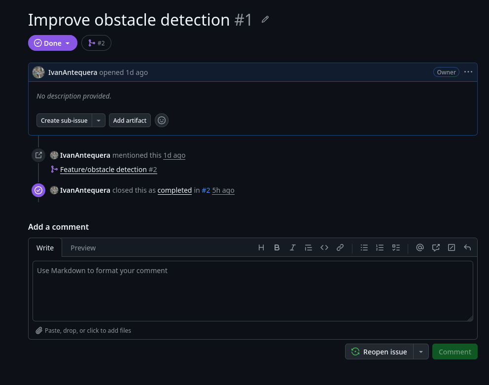
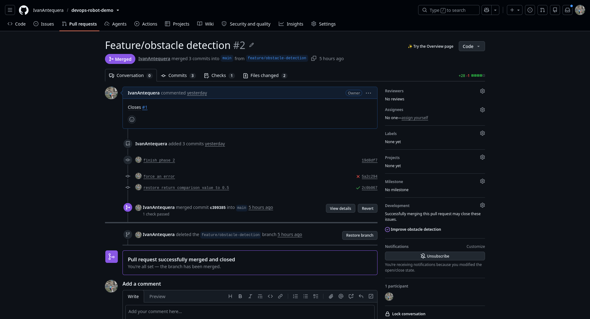
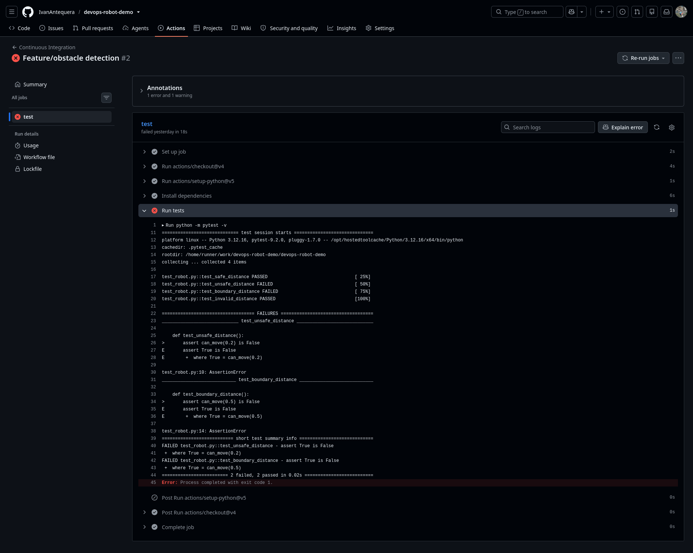
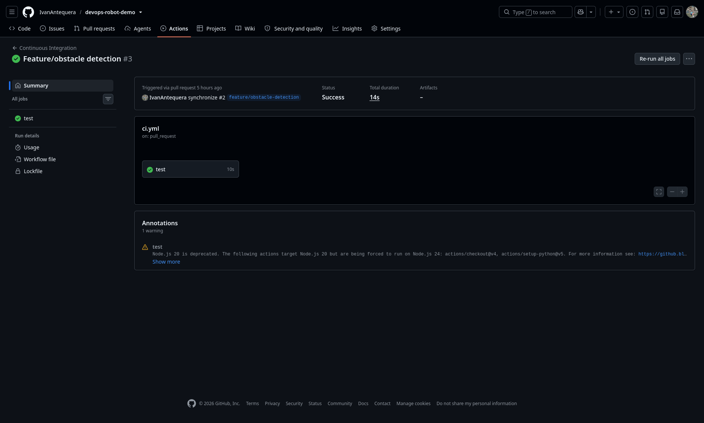
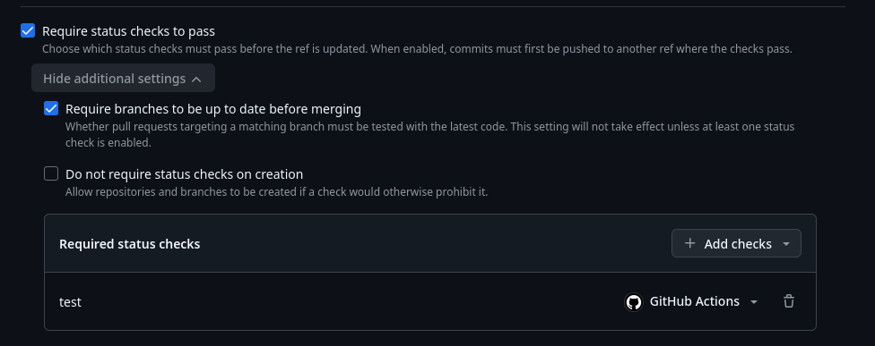
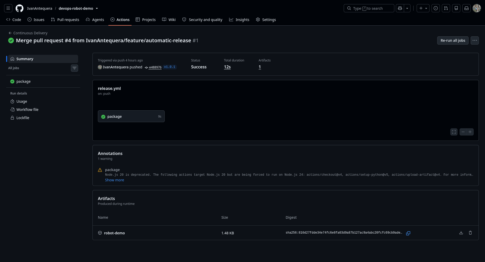

# devops-robot-demo

## Project Overview

This repository implements a basic DevOps workflow using Git, GitHub Actions, Pull Requests, and automated artifact packaging.

The module (`robot.py`) simulates a safety check for a mobile robot based on a distance sensor reading:

- **Distance > 0.5 m:** the robot can move (`True`).
- **0 ≤ Distance ≤ 0.5 m:** the robot must stop (`False`).
- **Distance < 0:** raises a `ValueError`.

---

## Phase 1: Repository Setup and Unit Tests

### Question: What happens at the exact boundary value of 0.5 meters?

At `0.5` meters, `can_move(0.5)` returns `False` because the condition uses `>` instead of `>=`. The robot is only allowed to move when the measured distance is strictly greater than `0.5` meters.

---

## Phase 2: Continuous Integration


- **Successful CI run:** 


### Check: What triggers the pipeline, and what happens if you change code without running tests locally?

The pipeline is triggered by `push` and `pull_request` events targeting the `main` branch, as configured in `.github/workflows/ci.yml`:

```yaml
on:
  push:
    branches: [main]
  pull_request:
    branches: [main]
```

If you change the code without running tests locally, GitHub Actions still runs them automatically when you open a Pull Request or push to `main`. If any test fails, the workflow fails and blocks merging (when branch protection is active). If all tests pass, it confirms the code passes those checks in a clean environment, though it does not rule out untested edge cases.

---

## Phase 3: Failure Diagnosis, Fix, and Branch Protection

- **Issue:** 


- **Pull Request:** 

- **Failed CI run:** 


- **Fixed CI run:** 



### Failure Analysis

On the `feature/obstacle-detection` branch, the condition in `robot.py` was temporarily changed from `distance > 0.5` to `distance > 0.1`. This caused two unit tests to fail:

- **`test_unsafe_distance`:** failed because `can_move(0.2)` returned `True` instead of `False` (`0.2 > 0.1`).
- **`test_boundary_distance`:** failed because `can_move(0.5)` returned `True` instead of `False` (`0.5 > 0.1`).

The remaining two tests (`test_safe_distance` and `test_invalid_distance`) passed because `1.0 > 0.1` is still `True` and `-1.0` still raises a `ValueError`.

```text
Run python -m pytest -v
============================= test session starts ==============================
platform linux -- Python 3.12.16, pytest-9.2.0, pluggy-1.7.0 -- /opt/hostedtoolcache/Python/3.12.16/x64/bin/python
cachedir: .pytest_cache
rootdir: /home/runner/work/devops-robot-demo/devops-robot-demo
collecting ... collected 4 items

test_robot.py::test_safe_distance PASSED                                 [ 25%]
test_robot.py::test_unsafe_distance FAILED                               [ 50%]
test_robot.py::test_boundary_distance FAILED                             [ 75%]
test_robot.py::test_invalid_distance PASSED                              [ 100%]

=================================== FAILURES ===================================
_____________________________ test_unsafe_distance _____________________________

    def test_unsafe_distance():
>       assert can_move(0.2) is False
E       assert True is False
E        +  where True = can_move(0.2)

test_robot.py:10: AssertionError
____________________________ test_boundary_distance ____________________________

    def test_boundary_distance():
>       assert can_move(0.5) is False
E       assert True is False
E        +  where True = can_move(0.5)

test_robot.py:14: AssertionError
=========================== short test summary info ============================
FAILED test_robot.py::test_unsafe_distance - assert True is False
 +  where True = can_move(0.2)
FAILED test_robot.py::test_boundary_distance - assert True is False
 +  where True = can_move(0.5)
========================= 2 failed, 2 passed in 0.02s ==========================
Error: Process completed with exit code 1.
```

**Fix:** Restored `return distance > 0.5` in `robot.py` without altering the tests, pushed the fix to the same branch, verified that the CI workflow passed, and merged the Pull Request into `main`.

### Recommended Extension: Branch Protection

Configured a branch protection rule on `main` requiring the `test` status check to pass before merging.



---

## Phase 4: Automated Delivery and Versioned Artifact

- **Version tag:** `[v1.0.0 or v1.0.1]`
- **Continuous Delivery run:** 


Pushing the version tag triggered `.github/workflows/release.yml`, which re-ran the full test suite and generated the downloadable `robot-demo` artifact.

### Artifact Inspection (`robot-demo.tar.gz`)

```bash
$ tar xvf robot-demo.tar.gz
./
./README.md
./robot.py

$ ls -l
total 12
-rw-r--r--. 1 user user 2844 Nov 26 19:45 README.md
-rw-r--r--. 1 user user 1367 Nov 26 18:45 robot-demo.tar.gz
-rw-r--r--. 1 user user  194 Nov 26 19:45 robot.py
```

### Reflection: Why is a version tag not the same as deploying to production?

A Git tag only marks a fixed commit in the repository's history. Even when it triggers an automated workflow that runs tests and builds `robot-demo.tar.gz`, it only produces a verified package ready for distribution—it does not install, configure, or start the software on a live system or physical robot.

---

## Phase 5: Technical Reflection

### 1. What is the benefit of running tests in GitHub Actions instead of only locally?
It runs tests in a clean, consistent environment every time, avoiding "works on my machine" issues. It also enforces testing automatically on every change rather than relying on manual habits, and leaves an auditable record of every run.

### 2. What happens when a Pull Request contains a bug?
The CI workflow runs automatically, marks the `test` check as failed, and displays the exact failure log inside the PR (as seen when the threshold was changed to `0.1`). With branch protection enabled on `main`, GitHub blocks the merge until the issue is fixed.

### 3. Why protect the `main` branch?
Protecting `main` prevents unverified code from entering the primary branch by requiring automated checks to pass before merging. This keeps `main` stable and always ready to produce a valid release.

### 4. What is the difference between CI, Continuous Delivery, and Continuous Deployment?
- **Continuous Integration (CI):** automatically builds and tests every code change integrated into the repository.
- **Continuous Delivery:** extends CI by automatically packaging a verified, versioned artifact ready for release, while keeping the final deployment to production a manual decision.
- **Continuous Deployment:** removes that manual gate and automatically deploys every change that passes the pipeline straight to production.

### 5. Are four unit tests enough to deploy software to a physical robot?
No. These four tests only check the logic of a single function against four ideal inputs. They do not verify hardware health (sensor noise or failure), real-world environment conditions, physical dynamics (inertia, braking distance), or security risks. Deploying to a real robot requires integration testing, simulation, security checks, rollback mechanisms, and explicit human approval.
